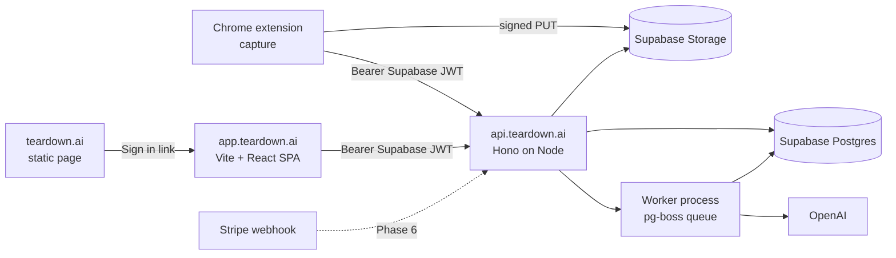

# Teardown — Build Plan

**What this document is.** The engineering reference for Teardown v1: how work is run, the
stack, repo layout, code conventions, schema, API, how each app is put together, the remaining
phases with their done-criteria, and the platform facts the code relies on. It describes the
code as built through Phase 5 (2026-09-26) and specifies what is still to build.

`spine.md` is the authority on the product and its architecture (what and why). This document is
the authority on how. If the two ever disagree, stop and resolve it rather than choosing one
silently. `STATUS.md` says where the build is; `decisions.md` records each decision and its reason.

---

## How work is run

These rules apply to anyone building Teardown, human or AI:

1. **Phase by phase.** Finish a phase's done-criteria before starting the next. Nothing from
   `backlog.md` gets built without the owner moving it into scope.
2. **Plan before building.** Before each phase (or any sizeable change), list the files to be
   created or changed and every decision this plan leaves open. Wait for the owner's go-ahead.
3. **Flag, don't work around.** If the plan and the spine conflict, or a library or API no longer
   behaves as documented here, stop and say so.
4. **Readable by a React-and-CSS developer who reads TypeScript**, not only by a framework
   expert. Follow the conventions below exactly. Prefer boring, explicit code.
5. **Verify library and API facts** against current docs before relying on them (OpenAI models,
   Supabase, Stripe, Chrome APIs, Notion) and record what was verified, with the date, in a code
   comment or in "Platform facts" below.
6. **Every phase ends with a report:** what was built, how to run it, what the owner must do by
   hand (env vars, dashboard settings), and what is not done.
7. **Keep the docs true.** A change to the product or architecture updates `spine.md`; a change
   to the stack, schema or API updates this document; each deliberate decision gets a numbered
   entry in `decisions.md`; `STATUS.md` is updated at the end of each phase.
8. **Prefer the better architecture now.** At this stage, doing it right beats doing less work.

---

## Stack

Supabase supplies Postgres, Auth and file storage. One small Node service supplies the API and
the worker. Both clients talk only to that service, plus Supabase Auth for sign-in and Supabase
Storage for the bytes of an upload.



| Layer              | Choice                                                                                                                                                         | Why this and not the alternative                                                                                                                                  |
| ------------------ | -------------------------------------------------------------------------------------------------------------------------------------------------------------- | ----------------------------------------------------------------------------------------------------------------------------------------------------------------- |
| Monorepo           | pnpm 12 workspaces, TypeScript 5.9, `packages/core` shared by every app                                                                                        | Turborepo is not needed at four packages; plain `pnpm -r` scripts are easier to read. TypeScript stays on 5.x because `typescript-eslint` does not support 7 yet. |
| Runtime            | Node 22                                                                                                                                                        | `pg-boss` 12 and `supabase-js` require it, for development as well as deploy.                                                                                     |
| Database           | Supabase Postgres; plain SQL migrations in `supabase/migrations/` applied with the Supabase CLI; queries through `postgres.js`, hand-written, one per function | An ORM hides the SQL you need to read when debugging. Migration files are the most readable schema record.                                                        |
| Auth               | Supabase Auth, Google provider, on both surfaces; the API verifies tokens against the project's JWKS with `jose`                                               | One identity system with a dashboard. Asymmetric signing keys are Supabase's current default; the legacy HS256 secret is not used.                                |
| File storage       | Supabase Storage, private buckets `originals`, `crops`, `audio`, `exports`; uploads through signed URLs                                                        | Same account as the database; S3-compatible if it ever moves.                                                                                                     |
| API                | Hono on Node, Zod validation at every route boundary with schemas from `core`                                                                                  | A few hundred lines to understand, no decorators or DI containers, route files read top to bottom.                                                                |
| Queue and worker   | pg-boss in a second process from the same package                                                                                                              | A Postgres-backed queue is enough at this scale; no Redis, no second vendor.                                                                                      |
| AI                 | OpenAI only: `whisper-1` for transcription, `gpt-6-luna` for generation and refine (Responses API), `web_search` tool for approved refines                     | See Platform facts. Model ids are constants in `apps/api/src/ai/models.ts`.                                                                                       |
| Image processing   | `sharp` in the API                                                                                                                                             | Crops region captures and shrinks images to the model's patch budget.                                                                                             |
| Web app            | Vite 8, React 19, React Router 8 (everything imported from `react-router`), TanStack Query 5, CSS modules, `react-markdown` + `remark-gfm`                     | No server rendering needed behind a login; every screen is a component calling a typed client.                                                                    |
| Extension          | MV3, esbuild (`build.mjs`, ~30 lines) into `dist/`; the panel is plain TypeScript + DOM, not React                                                             | React would be the extension's largest dependency, and the extension goes through Web Store review.                                                               |
| Payments (Phase 6) | Stripe Checkout in one-time `payment` mode, two Price IDs, one webhook (`checkout.session.completed`)                                                          | Prepaid packs need no subscriptions or customer portal.                                                                                                           |
| Hosting (Phase 8)  | Railway or Fly.io for the API and worker (two processes, one Dockerfile); Cloudflare Pages or Vercel for the web app and landing page                          | Long-lived Node, no job-duration cap, near-zero idle cost. Supabase Edge Functions are ruled out: Deno runtime and wall-clock limits.                             |

---

## Repo layout

Folders are named for what they hold, not for a pattern.

```
teardown/
  packages/core/src/
    schemas/            capture, session, transcript, document, credits, export, user (Zod)
    api-contract.ts     request/response schema for every /v1 endpoint
    clock.ts            sessionElapsedMs(startedAt, pausedMs)
    markers.ts          insertCaptureMarkers(words, captures) → marked transcript
    crop.ts             cropRectInPixels(rect, dpr, padding, bounds)
    outputContract.ts   image placeholders, refine contract checks, generation normalising
    documentTitle.ts    a document's title from its first heading
  packages/core/test/   Vitest suites for all of the above
  apps/api/src/
    server.ts           the HTTP API;  worker.ts  the queue consumer
    config.ts           the only reader of environment variables
    middleware/         auth.ts (JWT → userId), errorToJson.ts (AppError → JSON)
    routes/             me, sessions, captures, chunks, generate, documents (+ ownedSession)
    db/                 client.ts, queries/<table>.ts
    storage/            signedUpload, signedDownload, uploadObject, downloadObject,
                        deleteObjects, objectKeys
    queue/              boss.ts (queue names), enqueue.ts
    jobs/               transcribeChunk.ts, generate.ts
    ai/                 models.ts, openai.ts, transcribe.ts, analyze.ts, refine.ts,
                        markedTranscript.ts, modelImages.ts, modelText.ts, prompts/
    images/             cropCapture.ts, imageSource.ts
    billing/            ledger.ts (spendCredit, grantCredits)
  apps/api/scripts/     local dev tools (see STATUS.md); output/ and fixtures/ are gitignored
  apps/extension/
    manifest.json, build.mjs
    src/service-worker.ts          entry: message routing, commands, alarms, recovery
    src/service-worker/            session, captureQueue, uploader, injection, offscreen, nudges
    src/offscreen/                 recorder, levelMeter, offscreen (entry)
    src/content/                   content (entry), markup, regionEditor
    src/panel/                     panel.html/.css/.ts, filmstrip
    src/permission/                the microphone onboarding tab
    src/shared/                    messages, api, auth, idb, clock, sessionState, panelState,
                                   constants, buildConfig
  apps/web/src/
    router.tsx, main.tsx, config.ts, styles.css
    auth/               supabase client, sign-in, RequireAuth, useAuth
    api/                typed client + TanStack Query hooks per resource
    pages/              Login, AuthCallback, Library, Session, Account, NotFound
    components/         DocumentView, ImageLightbox, RevisionsPanel, VersionEntry,
                        RefineComposer, RefineReply, PendingSession, StatusBadge,
                        ConfirmDialog, Layout
  apps/landing/         (Phase 8) index.html, styles.css, privacy.html, terms.html
  supabase/migrations/  0001_init, 0002_chunk_words, 0003_version_tree
  docs/                 spine, build plan, status, decisions, backlog, development
  README.md             what Teardown is, how it works, the layout
  ROADMAP.md            the work ahead, phase by phase, then after launch
```

---

## Code conventions

These exist so the owner can edit by hand later.

1. **One concept per file**, named for the concept. No `utils.ts`, `helpers.ts`, `index.ts`
   barrels or `misc/` folders.
2. **Functions under ~40 lines**, with a one-line comment above each exported function saying
   what it does and, if not obvious, why. Comment the _why_ of anything that looks odd (the
   two-frame wait before capture, the row lock before a credit spend).
3. **Types come from Zod schemas in `core`**; `z.infer` is the only way a type is derived. No
   hand-maintained duplicates in clients.
4. **SQL is written out** in query functions, on multiple lines, one query per function. No
   query builders, no ORM, no string-built dynamic SQL.
5. **No classes** except where a library requires one (and `AppError` / `ApiError`). No
   decorators, dependency-injection containers, event buses or generic repositories.
6. **Errors** are thrown as `AppError(code, status, message)` and turned into JSON once, in one
   Hono middleware. Route handlers do not catch and re-wrap.
7. **Configuration** is read once in `config.ts`, validated with Zod at startup. No
   `process.env` anywhere else. (Scripts under `apps/api/scripts/` may read their own env.)
8. **React:** function components, hooks, CSS modules (no Tailwind, no CSS-in-JS), one component
   per file, props typed inline. Server state only through TanStack Query hooks named for what
   they fetch (`useSession(id)`, `useDocument(id)`); no global store.
9. **Extension messaging:** `apps/extension/src/shared/messages.ts` lists every message as a Zod
   discriminated union, and every sender and listener parses against it. **One exception:** the
   content script checks its two incoming message shapes by hand, because Zod is ~450 KB
   minified and the content script is injected into every recorded page. Everything it sends is
   parsed by the service worker.
10. **Tests:** Vitest for `core` (clock, markers, crop math, output contract, schemas) and for the
    ledger; an integration test for the Stripe webhook from a recorded event (both Phase 6).
    Nothing else is automated; manual test scripts live in `docs/development.md`.
11. **Dependencies:** add one only when it replaces more than ~100 lines. List each in `docs/development.md`
    with one line on what it is for.
12. **Formatting and linting:** Prettier defaults (double quotes, 80 columns); `typescript-eslint`
    recommended only.

---

## Data model

Migrations in `supabase/migrations/` are the only record of the schema. Never edit an applied
migration; add the next one. Apply with the Supabase CLI through `npx` (see `docs/development.md`).

`auth.users` is Supabase's; every other table is in `public`, keyed to it. All ids are UUIDs;
`captures.id` is generated by the extension so retried uploads upsert.

| Table                    | Columns                                                                                                                                                                                                                                                                                                           | Notes                                                                                                                                                                                                                          |
| ------------------------ | ----------------------------------------------------------------------------------------------------------------------------------------------------------------------------------------------------------------------------------------------------------------------------------------------------------------- | ------------------------------------------------------------------------------------------------------------------------------------------------------------------------------------------------------------------------------ |
| `users`                  | `id` (= auth.users.id), `email`, `created_at`, `deleted_at`                                                                                                                                                                                                                                                       | Created by a trigger on `auth.users` insert. `deleted_at` is set while delete-account runs so a half-deleted account cannot act; it is not a soft-delete flag.                                                                 |
| `sessions`               | `id`, `user_id`, `status` (`recording`, `review`, `syncing`, `processing`, `ready`, `failed`), `started_at`, `paused_ms`, `stopped_at`, `title`, `failed_step`, `created_at`                                                                                                                                      | `started_at` and `paused_ms` are the clock epoch every runtime uses. `failed_step` is `transcribe`, `crop`, `analyze`, `save` or `credits`. `title` is the document's first heading.                                           |
| `captures`               | `id` (client), `session_id`, `t_pick_start_ms`, `t_capture_ms`, `url`, `page_title`, `viewport_w`, `viewport_h`, `dpr`, `region_mode` (`viewport`, `freehand`, `element`), `region_rect` jsonb, `selectors` text[], `primary_element`, `padding`, `original_path`, `crop_path`, `element_text_hash`, `created_at` | Paths are storage keys, never URLs. `crop_path` is a cache, set only for region captures. `element`, `selectors`, `primary_element` and `element_text_hash` are reserved for element pick (`backlog.md`); nothing writes them. |
| `audio_chunks`           | `id`, `session_id`, `offset_ms`, `duration_ms`, `storage_path`, `status` (`uploaded`, `transcribed`, `failed`), `words` jsonb, `word_count` (generated, stored), `created_at`                                                                                                                                     | One row per chunk that passed the silence gate; unique on `(session_id, offset_ms)`. `words` is an array of `{ word, startMs, endMs }` on the session clock, in spoken order, checked to be an array.                          |
| `documents`              | `id`, `session_id` (unique), `current_version_id`, `created_at`                                                                                                                                                                                                                                                   | One per session. `current_version_id` is the version last viewed or created.                                                                                                                                                   |
| `document_versions`      | `id`, `document_id`, `version_no`, `markdown`, `source` (`generate`, `refine`), `parent_version_id`, `refine_prompt`, `note`, `model`, `created_at`                                                                                                                                                               | Append-only; a tree through `parent_version_id`. `note` is the model's one-line summary of the change.                                                                                                                         |
| `export_jobs`            | `id`, `document_id`, `connector` (`html`, `html_folder`, `obsidian`, `notion`), `status` (`queued`, `running`, `done`, `failed`), `result_path`, `external_url`, `error`, `created_at`, `finished_at`                                                                                                             | Phase 7. `result_path` for downloads, `external_url` for Notion.                                                                                                                                                               |
| `credit_ledger`          | `id`, `user_id`, `delta`, `reason` (`purchase`, `promo`, `spend`, `refund`), `stripe_event_id` (unique, nullable), `session_id` (nullable, set null on delete), `created_at`                                                                                                                                      | Append-only. The unique `stripe_event_id` makes webhook replays no-ops. Rows outlive their session.                                                                                                                            |
| `credit_balances` (view) | `user_id`, `balance`                                                                                                                                                                                                                                                                                              | `sum(delta)`; `security_invoker` so it respects RLS.                                                                                                                                                                           |
| `usage_events`           | `id`, `user_id`, `session_id` (set null on delete), `kind` (`transcribe`, `generate`, `refine`), `model`, `input_tokens`, `output_tokens`, `audio_seconds`, `image_count`, `image_pixels` jsonb, `web_searches`, `cost_usd_estimate`, `created_at`                                                                | One row per OpenAI call. `image_pixels` is `[{ w, h }]` per image actually sent.                                                                                                                                               |
| `promo_codes`            | `code`, `credits`, `max_redemptions`, `redeemed_count`, `expires_at`                                                                                                                                                                                                                                              | Phase 6 (spine §6.2).                                                                                                                                                                                                          |
| `connector_connections`  | `id`, `user_id`, `connector` (`notion`), `access_token` bytea, `workspace_name`, `created_at`                                                                                                                                                                                                                     | Phase 7. The token is `pgp_sym_encrypt`ed with a key only the API holds. Unique per user and connector.                                                                                                                        |

**Row Level Security** is enabled on every table with no policies; the API uses the service
role. **Deletion** cascades from `sessions` to captures, chunks, documents, versions and export
jobs. The API deletes storage objects first, then the row. Delete account deletes the
`<user_id>/` prefix in every bucket, then calls `auth.admin.deleteUser`, which cascades to
`users` and everything under it and revokes every refresh token.

**Storage keys:** `originals/<user>/<session>/<capture>.png`, `crops/<user>/<session>/<capture>.png`,
`audio/<user>/<session>/chunks/<offset_ms>.webm`, `exports/<user>/exports/<job>.<ext>`
(`storage/objectKeys.ts` is the one place that builds them). User id first makes delete-account a
prefix listing.

**Credit spend** (`billing/ledger.ts`) runs inside the generate job's save transaction:

```sql
-- Serialises spends per user: without it, two transactions can both read a balance of 1.
select id from users where id = $1 for update;

-- Inserts the spend only if the balance covers it; returns zero rows when it does not.
insert into credit_ledger (user_id, delta, reason, session_id)
select $1, -1, 'spend', $2
where (select coalesce(sum(delta), 0) from credit_ledger where user_id = $1) >= 1
returning id;
```

`grantCredits` inserts with `on conflict (stripe_event_id) do nothing`, so a replayed webhook
grants nothing.

---

## API

All under `/v1`, all Bearer-authenticated except the Stripe webhook and the Notion OAuth callback.
Request and response bodies are Zod schemas in `packages/core/src/api-contract.ts`, parsed by the
API and by both clients. Errors are `{ error: { code, message } }`. A resource that is not yours
is a 404, indistinguishable from one that does not exist. CORS allows `WEB_APP_URL` only (the
extension's requests come from its service worker and are not subject to CORS).

```
GET    /health                            unauthenticated, for the host

GET    /me                                profile, credit balance, connectors
DELETE /me                                delete account

POST   /sessions                          { startedAt } → session (extension)
GET    /sessions                          library list, newest first
GET    /sessions/:id                      detail + captures
GET    /sessions/:id/summary              capture count + word count (Stop screen)
POST   /sessions/:id/stop                 { stoppedAt, pausedMs } → review
POST   /sessions/:id/resume               { pausedMs } → recording ("keep going")
DELETE /sessions/:id                      storage objects, then rows (also Discard)

POST   /sessions/:id/captures/presign     { captureId } → { uploadUrl, token, path }
POST   /sessions/:id/captures             upsert the capture record (path must match the presign)
DELETE /sessions/:id/captures/:captureId  objects, then the row
POST   /sessions/:id/chunks/presign       { offsetMs } → { uploadUrl, token, path }
POST   /sessions/:id/chunks               register the chunk, queue transcribe-chunk

POST   /sessions/:id/generate             202 queued | 402 out of credits (from review or failed; from Phase 6 never 402)
POST   /documents/:id/unlock              Phase 6: spends one credit on a locked document | 402 at zero

GET    /documents/:id                     current version, version summaries, signed image URLs
GET    /documents/:id/versions/:n         one version
POST   /documents/:id/current             { versionId } → 204 (the viewed version becomes current)
POST   /documents/:id/refine              { prompt, fromVersionId?, allowWebSearch? }
                                          → 201 edited | 200 declined / no_change /
                                            needs_web_search | 422 contract failed

Phase 6
POST   /billing/checkout                  { pack } → { url }
GET    /billing/history                   ledger entries
POST   /billing/webhook                   Stripe (raw body, signature check)
(promo code redemption: entered on the payment page; endpoint designed at Phase 6 planning)

Phase 7
POST   /exports                           { documentId, connector, notionParentId? } → 202
GET    /exports?document=:id
GET    /exports/:id/download              302 to a signed URL
GET    /connectors/notion/start           302 to Notion OAuth
GET    /connectors/notion/callback        stores the token, 302 to /account
DELETE /connectors/notion
```

Pack ids are `pack_5` and `pack_15`, with credits and price in `core/schemas/credits.ts`; Stripe
Price ids are API config, mapped to credits server-side, never taken from the client.

---

## Auth setup

- **Google Cloud:** one OAuth client of type **Web application**, with two authorized redirect
  URIs: `https://<extension-id>.chromiumapp.org/` and `https://<project-ref>.supabase.co/auth/v1/callback`.
- **Supabase → Auth → Providers → Google:** that client's id and secret; the same id also under
  Authorized Client IDs (for the extension's ID-token sign-in).
- **Supabase → Auth → URL Configuration:** the web app's URL as Site URL and
  `<web app>/auth/callback` as a redirect URL.
- **Extension:** the client id in `manifest.json` (`oauth2.client_id`); the manifest `key` pins
  the extension id so the redirect URI never changes. `shared/auth.ts` runs `launchWebAuthFlow`
  (`response_type=id_token`, hashed nonce) then `signInWithIdToken`, with a `chrome.storage.local`
  storage adapter for the Supabase client.
- **Web app:** `signInWithOAuth` with PKCE; `AuthCallbackPage` exchanges the code explicitly
  (`detectSessionInUrl` off; one shared exchange per code, because React runs effects twice in
  development).
- **Sign-out** always passes `scope: "local"` (web app, extension, and the web app's 401
  handler). Supabase's default signs out every device.

---

## Extension build spec

Four runtimes, one message contract, one clock (spine §4, §7, §8).

| Runtime                                                 | Owns                                                                                                                                                                                                                                                                                                                                                           | Must not                                                                                     |
| ------------------------------------------------------- | -------------------------------------------------------------------------------------------------------------------------------------------------------------------------------------------------------------------------------------------------------------------------------------------------------------------------------------------------------------- | -------------------------------------------------------------------------------------------- |
| Service worker (`service-worker.ts`, `service-worker/`) | Session lifecycle (start, stop, resume, generate, discard, recovery); the Supabase client; the capture queue (one shot per 500 ms, presses within 300 ms coalesce, retry on the quota error); writing PNGs to IndexedDB; the upload queue (5 attempts, backoff); injecting the content script into the active tab and following tab changes; ⌘⇧S; nudge alarms | Hold state in memory; touch the DOM; run MediaRecorder; await a tab                          |
| Offscreen document (`offscreen/`)                       | `getUserMedia`; alternating 20 s MediaRecorders with 1 s overlap; RMS level every 100 ms for the meter; the silence gate (a chunk whose loudest 100 ms is under the threshold is skipped); dead-mic detection (near-zero signal for 10 s); handing finished chunks to the worker                                                                               | Use `chrome.storage` or any API except `chrome.runtime`; show UI                             |
| Content script (`content/`)                             | The toolbar and region editor in a closed shadow root; draw, move, resize, remove; hide + two frames before capture; `devicePixelRatio`; sending `{ region, dpr, tPickStart, tCapture, url, title, viewport }`; showing and hiding itself by watching the session in `chrome.storage.local`                                                                    | Call `captureVisibleTab`; store anything; import Zod                                         |
| Side panel (`panel/`)                                   | Views: signed out, idle (mic choice, Start, tips), recording (meter, filmstrip, capture, Stop, nudges, dead-mic alarm), review (quality read, filmstrip with delete, Keep going, Generate, Discard with inline confirm)                                                                                                                                        | Show a transcript, clock or word count while recording; render the document; use `confirm()` |
| Permission tab (`permission/`)                          | The microphone prompt, as the first onboarding step                                                                                                                                                                                                                                                                                                            | —                                                                                            |

**Shared modules** (`src/shared`): `messages.ts` (the Zod union; tab messages time out after 1 s),
`api.ts` (fetch with the Bearer token, typed by the API contract), `auth.ts`, `idb.ts` (blobs and
capture metadata), `clock.ts`, `sessionState.ts` (what lives in `chrome.storage.local` and
`.session`), `panelState.ts`, `constants.ts` (every tunable number in one place),
`buildConfig.ts` (Supabase URL, anon key and API/web URLs injected by esbuild from
`apps/extension/.env`).

**Capture path:** toolbar, panel or ⌘⇧S → content script hides itself, waits two frames, sends
`CAPTURE_REQUEST` → service worker queues it, `captureVisibleTab({ format: "png" })`, writes the
blob and metadata to IndexedDB, tells the panel (`CAPTURE_STORED`; the thumbnail is cropped to the
region) → uploader presigns, PUTs, registers. Retries reuse the capture id; the API upserts.

**Stop path:** stamp `stoppedAt` → `RECORDER_STOP` (the recorder finishes any rotation in flight
and hands over the last chunk) → the upload queue drains → `POST /stop` → review.

**Generate:** `POST /generate`; on 202 clear the local buffer and open
`<web app>/sessions/:id`; on 402 show "Out of credits" with a link to the web app (removed in
Phase 6, when Generate stops spending). **Discard:**
confirm inline → stop the recorder if needed → `DELETE /sessions/:id` (a 404 counts as done) →
forget locally. If the delete fails, the session stays and the user can retry.

**Build:** `pnpm --filter @teardown/extension build` (or `dev` to rebuild on save) produces
`dist/`, loaded unpacked. The bundle is minified; the content script must stay small.

---

## Web app build spec

One typed API client, no state outside TanStack Query and the URL.

| Route                                             | Screen                                                                                                                                                                                                                                                                                                      | Calls                                                                        | State                                                    |
| ------------------------------------------------- | ----------------------------------------------------------------------------------------------------------------------------------------------------------------------------------------------------------------------------------------------------------------------------------------------------------- | ---------------------------------------------------------------------------- | -------------------------------------------------------- |
| `/login`                                          | Google sign-in                                                                                                                                                                                                                                                                                              | Supabase Auth                                                                | Built                                                    |
| `/auth/callback`                                  | Finishes sign-in, returns to where the user was going                                                                                                                                                                                                                                                       | Supabase Auth                                                                | Built                                                    |
| `/`                                               | Library: newest first, title, date, capture count, status badge; delete (confirm dialog)                                                                                                                                                                                                                    | `GET /sessions`, `DELETE /sessions/:id`                                      | Built                                                    |
| `/sessions/:id`                                   | Pending: "Ready to generate" with Generate, or a step label while generating (polls), or failed with retry and no credit spent; out of credits message (until Phase 6)                                                                                                                                      | `GET /sessions/:id`, `POST /sessions/:id/generate`                           | Built (out-of-credits copy says packs arrive next phase) |
| `/sessions/:id` (locked)                          | Preview: title, all headings, one section in full, placeholder bars for the rest, capture count; Revisions panel shown locked with "Unlimited revisions after unlocking" and example requests; Unlock with the balance shown, or Buy credits at zero (checkout returns here)                                | `GET /documents/:id`, `POST /documents/:id/unlock`                           | Phase 6                                                  |
| `/sessions/:id` (ready)                           | Document with images from signed URLs; lightbox (← → between captures, Esc, "Open original"); Revisions panel beside it (a bottom drawer under 1000 px): history as a conversation, branch from any version, request box always visible with a "just ask" tip, search approval (Search and apply / Not now) | `GET /documents/:id`, `GET …/versions/:n`, `POST …/current`, `POST …/refine` | Built                                                    |
| `/account`                                        | Email, credit balance, delete account (type "delete my account")                                                                                                                                                                                                                                            | `GET /me`, `DELETE /me`                                                      | Built                                                    |
| `/billing`, `/billing/success`, `/billing/cancel` | Balance, two packs with Buy, purchase history                                                                                                                                                                                                                                                               | `GET /me`, `POST /billing/checkout`, `GET /billing/history`                  | Phase 6                                                  |
| Export menu and job list                          | HTML and Obsidian downloads, Notion "choose a parent page" then push                                                                                                                                                                                                                                        | `POST /exports`, `GET /exports`, `GET /exports/:id/download`                 | Phase 7                                                  |
| `/account` (Notion)                               | Connected workspace, connect / disconnect                                                                                                                                                                                                                                                                   | `GET /connectors/notion/start`, `DELETE /connectors/notion`                  | Phase 7                                                  |

A refine reply that is not an edit (declined, needs web search) shows in the panel for the visit
only. A 422 shows "That edit didn't take; try rewording" and the document stays as it was.

---

## AI

- **Models** (`ai/models.ts`): `TRANSCRIBE_MODEL = "whisper-1"`, `VISION_MODEL = "gpt-6-luna"`,
  with prices for the cost estimate. Changing a model is one line; re-verify its capabilities
  first (Platform facts).
- **Images** (`ai/modelImages.ts`): sent at `detail: "high"`, shrunk by us to fit 2,500 patches of
  32 × 32 px and never enlarged, so `usage_events.image_pixels` is exactly what was billed.
  `images/imageSource.ts` decides crop or original; `images/cropCapture.ts` derives and caches
  crops.
- **Prompts** (`ai/prompts/`): `analyze.v2.ts` and `refine.v3.ts`, plain text meant to be edited.
  A material change gets a new file; the version is recorded with the output.
- **Structured output:** refine answers through `text.format` with a strict JSON schema
  (`outcome`, `note`, `markdown`, `searchQuery`). The `web_search` tool is attached only when the
  user approved a search.
- **Output contract** (`core/outputContract.ts`): refine is checked (every image exactly once,
  0.5–2× length, ≥ 40% of distinct words kept, no raw HTML); generation is normalised instead of
  checked (spine §12).

---

## Remaining work by phase

| Phase                           | State                                        | Build                                                                                                                                                                                                                                                                                                                                                                                                                                                                                                                                                                                                                                                                                                                                                                                                                                                                                                                                                                                                            | Done when                                                                                                                                                                                                                                                                                                                                                                                                                                                  |
| ------------------------------- | -------------------------------------------- | ---------------------------------------------------------------------------------------------------------------------------------------------------------------------------------------------------------------------------------------------------------------------------------------------------------------------------------------------------------------------------------------------------------------------------------------------------------------------------------------------------------------------------------------------------------------------------------------------------------------------------------------------------------------------------------------------------------------------------------------------------------------------------------------------------------------------------------------------------------------------------------------------------------------------------------------------------------------------------------------------------------------- | ---------------------------------------------------------------------------------------------------------------------------------------------------------------------------------------------------------------------------------------------------------------------------------------------------------------------------------------------------------------------------------------------------------------------------------------------------------- |
| 0 Scaffold                      | Done                                         | Workspace, `core` with tests, schema, API skeleton, README                                                                                                                                                                                                                                                                                                                                                                                                                                                                                                                                                                                                                                                                                                                                                                                                                                                                                                                                                       | —                                                                                                                                                                                                                                                                                                                                                                                                                                                          |
| 1 Spikes                        | Done                                         | Offscreen mic, capture → storage round trip, shadow-root overlay, extension sign-in                                                                                                                                                                                                                                                                                                                                                                                                                                                                                                                                                                                                                                                                                                                                                                                                                                                                                                                              | Findings are in Platform facts below                                                                                                                                                                                                                                                                                                                                                                                                                       |
| 2 Backend core                  | Done                                         | Sessions, uploads, chunk transcription, summary, hard-delete cascade, `usage_events`                                                                                                                                                                                                                                                                                                                                                                                                                                                                                                                                                                                                                                                                                                                                                                                                                                                                                                                             | —                                                                                                                                                                                                                                                                                                                                                                                                                                                          |
| 3 Extension capture path        | Done                                         | Recorder, capture queue, uploader, content script, panel, nudges                                                                                                                                                                                                                                                                                                                                                                                                                                                                                                                                                                                                                                                                                                                                                                                                                                                                                                                                                 | —                                                                                                                                                                                                                                                                                                                                                                                                                                                          |
| 4 Generation                    | Done                                         | Generate job, prompts, credit spend, refine with contract                                                                                                                                                                                                                                                                                                                                                                                                                                                                                                                                                                                                                                                                                                                                                                                                                                                                                                                                                        | —                                                                                                                                                                                                                                                                                                                                                                                                                                                          |
| 5 Web app minimum               | Built; the owner's end-to-end run is pending | Login, library, session and document views, Revisions panel, lightbox, account and delete account                                                                                                                                                                                                                                                                                                                                                                                                                                                                                                                                                                                                                                                                                                                                                                                                                                                                                                                | Record → Generate opens the web app → document renders → refine works → delete account removes every row and object (docs/development.md → Manual test scripts)                                                                                                                                                                                                                                                                                            |
| 6 Billing                       | Next                                         | Stripe Checkout and webhook; `/billing` screens with success and cancel; 402 from Unlock leads to checkout (replace the web app's "next phase" copy; the extension's out-of-credits message goes, since Generate no longer returns 402); the credit balance visible everywhere (the web app's top bar on every page, and the extension panel next to Generate); a promo code field on the payment page (spine §6.2); the locked preview for every generation (spine §6.1: Generate never spends, the save writes the document locked, `POST /documents/:id/unlock` spends the credit, the API sends only the preview part, no limit on waiting previews); the locked page's Revisions panel says revisions are unlimited; the extension's idle panel says at zero credits that Generate shows a preview; Buy credits in both clients returns to the page it started from; the library flags sessions waiting to be generated or unlocked; Vitest for `ledger.ts`; webhook integration test from a recorded event | A test-mode purchase credits the ledger once even when the webhook is replayed; out of credits leads to checkout and Unlock succeeds after paying; a promo code grants once per user and stops at its limit; the balance is visible in the web app and the extension; Generate produces a locked preview whose hidden text is absent from every API response, and Unlock spends one credit with no second generation (402 at zero, then checkout and back) |
| 7 Exports                       | —                                            | `Connector` interface; HTML (embedded and folder ZIP); Obsidian ZIP; Notion OAuth and push (verify the upload API first, spine §17.3); decide the export controls and formats first (spine §17.4); an experiment: a second prompt that turns a session into an FAQ, to see whether it is worth offering; export menu and job list; exports use the current version                                                                                                                                                                                                                                                                                                                                                                                                                                                                                                                                                                                                                                               | Each of the three opens correctly in its destination with every image; the Obsidian ZIP unzips into a vault with working links                                                                                                                                                                                                                                                                                                                             |
| 8 Landing and deploy            | —                                            | Landing page and policy/terms shells (`apps/landing`); API and worker on the chosen host; static hosting and DNS; production Supabase, Google and Stripe configuration; a Web Store ZIP build script; start OAuth consent verification. Settle the product name and domain first (spine §17.5). Suggest template services for generating the privacy policy and terms. The owner is new to Railway and Fly: explain the hosting choice and walk through the setup                                                                                                                                                                                                                                                                                                                                                                                                                                                                                                                                                | teardown.ai → sign in → record with the packaged extension → pay → export, on production, from a clean machine                                                                                                                                                                                                                                                                                                                                             |
| 9 Instrumentation and hardening | —                                            | A "what did this session cost" report from `usage_events`; `tPickStart` → `tCapture` gap report; chunk-boundary drop report; request size limits; per-generation caps and rate limits with placeholder constants (spine §6.4); a head-to-head test of the chunk stitching against a whole-recording transcription pass at Stop, on real sessions (spine §9.1)                                                                                                                                                                                                                                                                                                                                                                                                                                                                                                                                                                                                                                                    | A query answers "what did this session cost", the three measurements exist, the limits return clear errors, and the transcription test has picked a winner                                                                                                                                                                                                                                                                                                 |

After Phase 9 the spine's §18 release checklist takes over.

### Landing page (Phase 8)

One static page at teardown.ai whose job is to explain the product in under a minute and send
the visitor to `app.teardown.ai/login`. It is also the OAuth consent-screen homepage and must link
to a live privacy policy and terms.

Sections, top to bottom: headline and one-sentence problem; a 30-second explanation of the flow
(narrate, capture, generate) with three stills from a real session; what you get (HTML, Obsidian,
Notion); pricing with the two packs and "no subscription, credits never expire"; a "Get the
extension" button (placeholder until the listing exists) and a "Sign in" button; footer with
privacy, terms and a contact address. Files: `apps/landing/index.html`, `styles.css`,
`privacy.html`, `terms.html`, `images/`. No JavaScript beyond optional analytics. The policy and
terms pages get shells with the headings from spine §14; the owner supplies the legal text.

---

## Platform facts we rely on

Verified while building (dates are when checked). If one stops being true, code breaks in the
place named.

**Chrome (MV3)**

- `captureVisibleTab({ format: "png" })` returns physical pixels (a 2032 × 1374 CSS viewport at
  dpr 2 → 4064 × 2748), ~190 ms per call, ~0.8 MB for a text-heavy page. Past about two calls a
  second it fails with an error containing `MAX_CAPTURE_VISIBLE_TAB_CALLS_PER_SECOND`
  (`captureQueue.ts` retries on it). (2026-09-19)
- The microphone permission prompt cannot appear from a side panel, popup or offscreen document
  (`getUserMedia` fails as if dismissed). A full extension tab can ask, and the grant then
  applies to the offscreen document. Device labels only appear after the grant; re-list on
  `devicechange` and visibility. (2026-09-19)
- The offscreen document has `chrome.runtime` messaging only. Its AudioContext must be resumed
  explicitly. (2026-09-19)
- A single MediaRecorder with a timeslice produces header-less fragments; each chunk must be its
  own recording. (2026-09-21)
- Chrome freezes background tabs; `chrome.tabs.sendMessage` to a frozen tab can hang forever
  (Chromium issue 40901394). (2026-09-24)
- `confirm()` and `alert()` are not shown in a side panel and return false. (2026-09-24)
- An overlay hidden with `visibility: hidden` plus two frames can still appear in the shot;
  `display: none` plus two frames does not. (2026-09-19)
- `event.composedPath()` is empty once dispatch ends. (2026-09-19)
- `launchWebAuthFlow` needs a Google OAuth client of type Web application with the
  `chromiumapp.org` redirect URI; a Chrome Extension client fails with `redirect_uri_mismatch`.
  Redirect URI changes take minutes to propagate, which looks like the same error. The flow always
  opens a popup window. (2026-09-19)
- `crypto.getRandomValues` fills at most 64 KB per call. (2026-09-19)

**Supabase**

- Signed uploads: presign with upsert (`createSignedUploadUrl(path, { upsert: true })`), or a
  retry to the same path fails with 409. A raw PUT to the signed URL works. A 6 MB upload works on
  the free tier (limit 50 MB). (2026-09-19)
- New projects sign tokens with asymmetric keys; verify against
  `<SUPABASE_URL>/auth/v1/.well-known/jwks.json` with issuer `<SUPABASE_URL>/auth/v1` and audience
  `authenticated`. (2026-09-19)
- `auth.signOut()` defaults to every session of the user; pass `scope: "local"`. (2026-09-24)
- The direct database host is IPv6-only; on an IPv4-only network use the session pooler
  connection string from the dashboard's Connect panel. (2026-09-19)
- `npx supabase@latest db push --db-url "<DATABASE_URL>"` applies migrations with no install,
  link or Docker. (2026-09-26)

**OpenAI**

- `whisper-1` is the only transcription model that returns word timestamps
  (`timestamp_granularities: ["word"]`); $0.006 a minute; 25 MB per request. (2026-09-19)
- `gpt-6-luna`: $0.10 / $0.50 per million input / output tokens; accepts images. At
  `detail: "high"` an image costs up to 2,500 patches of 32 px, smaller images are never enlarged,
  and billed tokens came out at ~1.2× patches. `gpt-6-sol` is the next tier at ~20× the price.
  (2026-09-24)
- The `web_search` tool works with `gpt-6-luna` alongside a strict JSON schema; in that mode
  there are no citation annotations. $10 per 1,000 searches plus tokens. (2026-09-26)

**Tooling**

- `pg-boss` 12: named import `{ PgBoss }`; a work handler receives an array of jobs.
- pnpm 12 blocks dependency install scripts by default; `esbuild` is allow-listed in
  `pnpm-workspace.yaml`, as are minimum-release-age exceptions.
- React runs effects twice in development, so one-shot effects (the OAuth code exchange) share a
  promise.

---

## Things only the owner can do

- Stripe: products, the two prices, test and live keys, the webhook endpoint, Stripe Tax.
- Domain, DNS and hosting accounts; production Supabase project and its Google provider settings.
- Google Cloud: the OAuth consent screen and its verification.
- The privacy policy and terms text (spine §14), and the DPA template.
- The Chrome Web Store developer account and listing.
